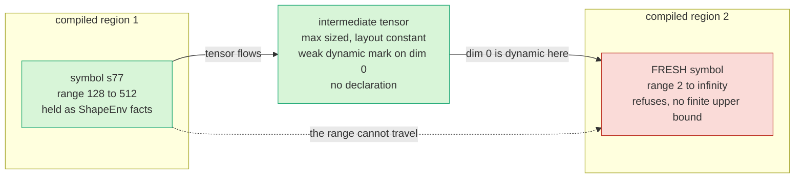
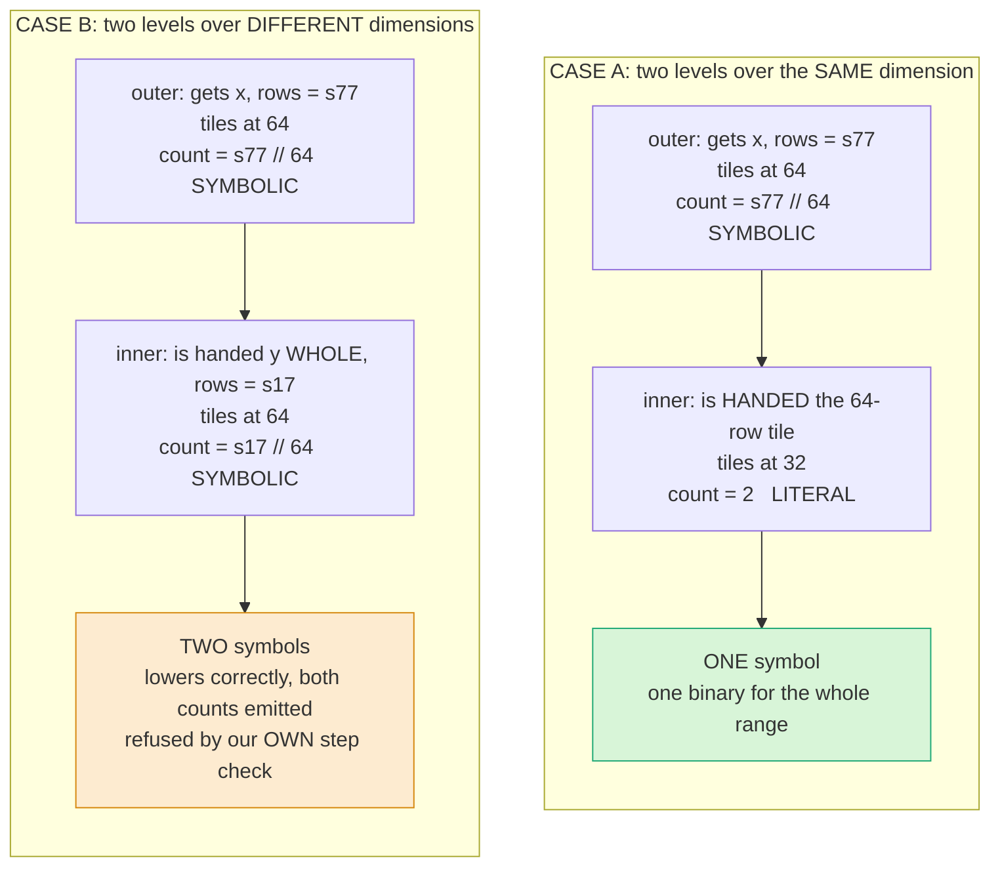

# Symbolic shapes: three questions

Everything below was measured on device. Where something is unmeasured it says so.

---

# Q1. Does the symbol flow across kernels and intermediate tensors

Two different boundaries, two different answers.

## Kernel to kernel, inside one compile

The chain raised in review was `host -> HBM -> kernel 1 -> (op) -> HBM -> kernel 2 -> fails`. The
concern was real: the contract has exactly one writer, inside the transfer, so a tensor born on the
device never passes it.

Four-stage chain, measured:

| What | Result |
|---|---|
| the intermediate's declaration | **None**, as predicted. It is device born |
| the intermediate's size | 65536 bytes at every size, which is the declared maximum |
| compiles | one kernel per stage, four traces for four stages |
| numbers | worst relative error 0.0040 |
| with an ATen fallback in the chain | correct, one kernel for the whole range |

**The `-> fails` step did not happen on any constructible path.**

Why a device-born tensor with no contract is harmless:

> **Binary reuse follows from layout constancy, not from the declaration.**

Dynamo guards every device tensor on its device layout. The buffer is reserved at the maximum, so it
presents the **same layout at every size**, the guard passes and the binary is reused. The
intermediate does not need the contract. It needs the same shape of memory, which it has, because our
codegen sized it at the maximum.

## Compile to compile

Here the answer splits, and this is the result that matters most.

> **The symbol crosses. The range does not.**



Region 2 refuses:

```
Unsupported: symbolic loop count (s77//64) has no finite upper bound, so SDSC codegen
cannot describe the tiled dimension's extent. Declare the range for ['s77'] in the
traced region
```

**The refusal is the proof the symbol arrived.** A region that had seen a concrete size would have
compiled happily.

### Why the symbol crosses but the range does not

The marks are different, and this was measured with two distinct code objects so it is not Dynamo's
per-code-object automatic dynamic:

```python
def stage1(x): return torch.nn.functional.gelu(x) + 1.0
def stage2(x): return torch.nn.functional.relu(x) * 2.0

x = torch.randn(256, 64)
torch._dynamo.mark_dynamic(x, 0)

torch.compile(stage1, dynamic=None)(x)   # -> stage2 then sees ['s77']
stage1(x)                                # -> stage2 then sees []
```

```
marked input : _dynamo_dynamic_indices      = {0}    strict, set by the transfer
compiled out : _dynamo_weak_dynamic_indices = {0}    weak, set by the compiled region
```

So the next region goes dynamic from its first trace. But each `torch.compile` has its own ShapeEnv,
so it mints a **fresh** symbol with the default range.

The range was never on the mark. The mark is bare on purpose, because passing bounds installs a strict
constraint that the granularity check then appears to violate. The range lives as `torch._check` facts
inside one region's ShapeEnv, and **a ShapeEnv does not leave its compile.**

| Property | Crosses? |
|---|---|
| allocation and layout | **yes**, the buffer is physically max strided |
| dynamism, that this dim varies | **yes**, the weak mark rides on the tensor |
| the range | **no**, it is ShapeEnv state |

### What this means for the plan

Today the caller states the range twice: once in `dynamic=` for the allocator, once in `torch._check`
for the compiler. The follow-up reads the declaration off the graph input and re-installs those facts
into each region's own ShapeEnv. **That is the whole of it.** The interface does not change.

---

# Q2. Does this end up like the hint PR

## What killed that one

It moved hints from declaring a trip **count** to declaring a tile **size**. Same direction this needs.
It took a month and did not merge.

The reviewer named the root cause:

> Spyre hints tile **abstract dimensions** not tensors. The mapping of loop dimensions to operation
> dimensions to tensor dimensions is **indirect** via named dimensions.

The author's own conclusion, after deleting every special case he had added, net minus 41 lines:
*"every special case I was adding was an artifact of measuring the wrong thing."*

The sentence that transfers:

> **A count is invariant to which loop var a name lands on. A size is not.**

`[B,H]` with `B=1` folds onto one loop var of extent 8, so inspecting the op recovers 8 for `B` when
the answer is 1. Hardware caught the end state: `declared tile_size 1 vs derived extent 64`.

## Why the mechanism cannot recur


Three reasons, each verified in the tree rather than argued.

**There is no name, so nothing to resolve.** `for_each_tile` is handed its operands and divides the
tensor in hand. Zero references to `named_dim`, `spyre_hint`, `declare_tensor_dim`,
`num_tiles_per_dim` or `tile_size_per_dim` in the construct or its lowering.

**A nested level is handed the enclosing level's tile**, so its units are correct by data flow rather
than by a lookup that could resolve wrongly.

**The compiler never reads the declaration.** `reserved_dims` appears zero times in the whole tree.
The granularity is recovered out of `FloorDiv(s, G)`, so the bundle's declared granularity and the
loop's step come from one expression and cannot disagree.

And hints were being retired for higher-order operators anyway. `for_each_tile` is the construct that
replaced them, so this is built on the replacement rather than on the thing that failed.

## Where it can still reach us

Four places, worth saying before anyone finds them.

**The attention tile-size search is the live instance.** The chooser searches an extent for an exact
divisor, and a search over divisors cannot survive a symbolic extent. The fix is that PR's own thesis
applied at the call sites: declare the size, derive the count. Phase 1 does not route through it.
Phase 2 does.

**The follow-up region builder is a decomposition, so it cannot call `.to()`.** Identical shape to the
withdrawn SDPA half of that PR.

**Phase 1 is safe by narrowness, not by construction.** With dim 0, outermost, one level, the tensor
axis and the loop variable coincide. For nesting they do not.

**One sentence in the design doc is currently the bug.** It has the region builder taking its tile
"from the same object" as the declaration. At an inner level that is exactly the defect above. It was
tested on device and refuses loudly, so a violation costs a failed compile rather than a wrong answer,
but the sentence needs tightening before the builder is written.

## The part worth taking seriously

That PR was technically correct at the end, hardware verified, net negative lines, and it still did
not merge. **What cost the month was implementing before the semantics were agreed.** What turned it
round was one page of semantics.

So before the follow-up: one page saying which quantity is declared, which derived, in what units, and
a single policy for a non-dividing extent. Agreed first, built second.

---

# Q3. Is Phase 2 an extension, including nested symbolic loops

Phase 2's actual shape was run on device. Five arms:

| arm | verdict | trip counts per level |
|---|---|---|
| one level | REUSE | `('floor(s77/64)',)` |
| two symbolic dimensions | REFUSE at launch | `('floor(s77/64)', 'floor(s17/64)')` |
| same dim, 64 then 32 | REUSE | **`('floor(s77/64)', '2')`** |
| same dim, inner 48 does not divide | REFUSE, names both numbers | - |
| inner level handed the contract granularity | REFUSE, same message | - |

## The two nesting cases



The code difference is one argument, and it is the whole argument:

```python
# CASE A: the inner level receives the TILE
def outer_body(_c, tiles):
    x_tile, w_whole = tiles                  # x_tile is 64 rows, a literal
    _ic, out = for_each_tile(inner_body, (x_tile, w_whole),
                             dims=(0, None), tile_size=32, out_dim=0)

# CASE B: the inner level receives the WHOLE other tensor
def outer_body(_c, tiles):
    x_tile, y_whole = tiles                  # y untouched, still carries its symbol
```

A level divides the tensor it was handed. In case A it was handed a tile, so its units are the tile's.
In case B it was handed a whole tensor, so its units are that tensor's. **Neither resolves a name, so
neither can be in the wrong units.**

Addresses stay safe too. A two-level nest's affine map is `base + i*stride_i + j*stride_j`, and both
strides are static because the buffer is max strided.

## When two symbols are actually needed

Less often than it looks.

| case | symbolic dims |
|---|---|
| decoder, packed token count | 1 |
| encoder dynamic batching | 1 |
| variable sequence length | 1, needs the non-outermost axis |
| paged attention decode | 1, the block count. Query length is 1 |
| full prefill, query and KV both varying | 2 **unless tied**, and in a full prefill they are equal, so an equality check collapses them to 1 |

The genuinely two-symbol case is chunked prefill with an independently varying chunk size and KV
length. Real, but narrower than "any attention model".

## What Phase 2 waits on, none of it design

The reservation accepting a non-outermost axis, which is what a variable sequence length needs. Runtime
capability work.

Relaxing the job-plan step check, which is **our own** C++ hard-coding a two-step shape. Honest caveat:
we know `steps[1]` is not a Compute and we did **not** capture what it is. Dump the step kinds before
writing the fix.

Reversing the derivation in the attention decomposition, one change in three call sites.

## Why this is unlike the WSR 1 to WSR 2 transition

WSR 1 needed a redesign because the **mechanism** was wrong: an indirect, lossy map from names to
tensor axes. The fix was a different addressing model, not a capability.

Here the addressing model is "a level divides the tensor it was handed", and nesting is the same
operation applied to the result. There is no map to get wrong, so there is nothing for a later phase to
discover is unsound.

| would force a redesign | state |
|---|---|
| a nested level in the wrong units | impossible by construction |
| the inner count turning out symbolic | **measured, it is a literal.** Main open risk, now closed |
| the builder passing the contract granularity inward | a rule for code not yet written. Tested, refuses loudly |
| the declared axis not being outermost | real, but runtime capability |

## What is open

**Three levels is unmeasured.** One and two were run. No real case has been found that needs three.

**The dispatch count grows multiplicatively** with two symbolic levels, and whether that crosses a
threshold where the saved compiles stop paying is not measured.

**How many of our own guards assume one level.** The step check is one we found. Expect one or two
more of that kind, each a hard-coded shape in a validator rather than anything in the lowering.

---

# The position in three lines

**Cross-kernel.** Data and layout flow correctly, intermediates land at the maximum, and binaries are
reused. Only the range needs carrying, and that is one follow-up PR that does not change the interface.

**The hint PR.** Its failure was name resolution through a lossy map. There is no name here, a level is
handed its tensor, and the compiler never reads the declaration. The lesson worth keeping is the
process one: agree the semantics on one page before building.

**Phase 2.** Not a redesign. Its shape was run on device, the lowering produced the right thing, and
what stopped it was an assertion we wrote ourselves.

Eight experiments. **Every failure mode found is a refusal or a retrace. No path was found that
compiles, runs and returns a wrong answer.**
