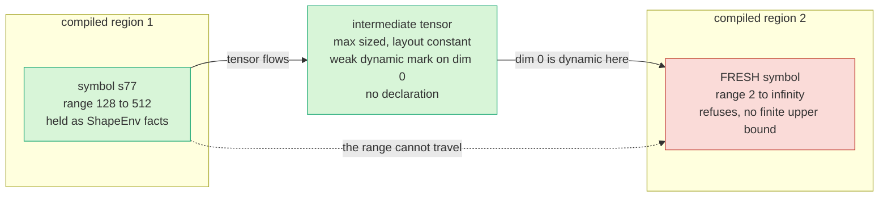
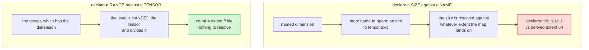

# Symbolic shapes: design concerns

Three concerns raised in review, each answered from measurements on device. Where something is
unmeasured it says so.

---

# 1. Does the contract survive across kernels and across compiled regions

Two different boundaries, with two different answers.

## Kernel to kernel

The concern was structural. The contract has exactly one writer, inside the host-to-device transfer,
so a tensor born on the device never passes it. A model is a chain of kernels handing tensors to each
other, so if the contract is lost at the first hand-off the feature is useless.

The chain under test:

```python
blk1 = torch.compile(region(), backend="inductor", fullgraph=True)
blk2 = torch.compile(region(), backend="inductor", fullgraph=True)

for rows in (128, 256, 384, 512):
    x = host.to("spyre", dynamic={0: dict(min=128, max=512, granularity=64)})

    mid = blk1(x, W)        # device born. Never passed through .to()
    out = blk2(mid, W)      # consumes a tensor that carries no declaration

    print(rows, nbytes(mid), get_reserved_dims(mid), misses())
```

Measured over a four-stage version of this:

| What | Result |
|---|---|
| the intermediate's declaration | **None**, as predicted. It is device born |
| the intermediate's size | 65536 bytes at every size, which is the declared maximum |
| compiles | one kernel per stage, four traces for four stages |
| numbers | worst relative error 0.0040 |
| with an ATen fallback in the chain | correct, one kernel for the whole range |

The chain did not fail at any size, with any form of intermediate.

Why a device-born tensor with no contract is harmless:

> **Binary reuse follows from layout constancy, not from the declaration.**

Dynamo guards every device tensor on its device layout. The buffer is reserved at the maximum, so it
presents the **same layout at every size**, the guard passes, and the binary is reused. The
intermediate does not need to carry the contract. It needs the same shape of memory, which it has,
because our codegen sizes it at the maximum.

## Compiled region to compiled region

Here the answer splits, and this is the result that matters most.

> **The symbol crosses. The range does not.**



Region 2 refuses:

```
Unsupported: symbolic loop count (s77//64) has no finite upper bound, so SDSC codegen
cannot describe the tiled dimension's extent. Declare the range for ['s77'] in the
traced region
```

**The refusal is the proof the symbol arrived.** A region that had seen a concrete size would have
compiled happily.

### Why the symbol crosses and the range does not

The two marks are different. Measured with two distinct code objects, so the result is not Dynamo's
per-code-object automatic dynamic:

```python
def stage1(x): return torch.nn.functional.gelu(x) + 1.0
def stage2(x): return torch.nn.functional.relu(x) * 2.0

x = torch.randn(256, 64)
torch._dynamo.mark_dynamic(x, 0)

torch.compile(stage1, dynamic=None)(x)   # stage2 then sees ['s77']
stage1(x)                                # stage2 then sees []
```

```
marked input : _dynamo_dynamic_indices      = {0}    strict, set by the transfer
compiled out : _dynamo_weak_dynamic_indices = {0}    weak, set by the compiled region
```

So the next region goes dynamic from its first trace. But each `torch.compile` has its own ShapeEnv,
so it mints a **fresh** symbol with the default range.

The range was never on the mark. The mark is bare on purpose, because passing bounds installs a strict
constraint that the granularity check then appears to violate. The range lives as `torch._check` facts
inside one region's ShapeEnv, and **a ShapeEnv does not leave its compile.**

| Property | Crosses a compiled region boundary |
|---|---|
| allocation and layout | **yes**, the buffer is physically max strided |
| dynamism, that this dim varies | **yes**, the weak mark rides on the tensor |
| the range | **no**, it is ShapeEnv state |

### What this means for the plan

Today the caller states the range twice: once in `dynamic=` for the allocator, once in `torch._check`
for the compiler. The follow-up reads the declaration off the graph input and re-installs those facts
into each region's own ShapeEnv. **That is the whole of it.** The interface does not change.

---

# 2. How this differs from the named-dimension hint approach

## The design difference

| | named-dimension hints | this design |
|---|---|---|
| what is declared | a tile **size**, against an abstract name | a **range**, against a tensor dimension |
| how it reaches a tensor | name, to operation dim, to tensor axis. Indirect | the loop level is handed the operand and divides it |
| what crosses into the compiler | a size, whose meaning depends on which loop variable the name lands on | a count |
| what can go wrong | the same declared number means different things in different programs | there is no name, so there is nothing to resolve |

The one sentence that separates them:

> **A count is invariant to which loop var a name lands on. A size is not.**

`[B,H]` with `B=1` folds onto one loop var of extent 8, so inspecting the operation recovers 8 for `B`
when the answer is 1. That is how a declared tile of 1 ended up applied to an extent of 64.



## Why the failure mode cannot arise here

Three properties, each verified in the tree rather than argued.

**There is no name.** `for_each_tile` is handed its operands and divides the tensor in hand. Zero
references to `named_dim`, `spyre_hint`, `declare_tensor_dim`, `num_tiles_per_dim` or
`tile_size_per_dim` in the construct or its lowering.

**A nested level is handed the enclosing level's tile**, so its units are correct by data flow rather
than by a lookup that could resolve wrongly.

**The compiler never reads the declaration.** `reserved_dims` appears zero times in the whole tree.
The granularity is recovered out of `FloorDiv(s, G)`, so the bundle's declared granularity and the
loop's step come from one expression and cannot disagree.

Also worth stating: hints were being retired for higher-order operators in any case, and
`for_each_tile` is the construct that replaced them.

## What this means for paged attention and SDPA

**Paged KV decode is already in the right shape.** That path already runs on `for_each_tile` by
default. The tiled axis is dim 0 of the block index and its mask, so the varying size already reaches
only the trip count. Paged attention is a custom op, so it does not route through the attention
decomposition at all. Declaring the block table's row count is therefore an extension of what that
code already does, not a change to how it tiles.

**SDPA is the one place the old failure mode could reach us.** The tile chooser searches an extent for
an exact divisor, and a search over divisors cannot survive a symbolic extent. It is the same category
of mistake: recovering a size by inspection rather than taking it as declared. The fix is the same
correction, applied at the call sites, which is to declare the size and derive the count. One change
in three call sites.

Phase 1 does not route through that chooser. Phase 2 does, which is why it is on the list.

## Two other places to watch

**The follow-up region builder is a decomposition, so it cannot call `.to()`.** It has to resolve a
declaration by identity instead, which is why the declaration object needs to land before the builder
is written.

**Phase 1 is safe by narrowness rather than by construction.** With dim 0, outermost, one level, the
tensor axis and the loop variable coincide. For nesting they do not, so the rule has to be written down
rather than relied on.

## The process point

That work was technically correct at the end, hardware verified, and still did not merge, because it
was implemented before the semantics were agreed. The cheap insurance is one page first: which quantity
is declared, which is derived, in what units, and a single policy for a non-dividing extent. Agreed,
then built.

---

# 3. Is Phase 2 an extension of Phase 1

Phase 2's shape was run on device. Five arms:

| arm | verdict | trip counts per level |
|---|---|---|
| one level | REUSE | `('floor(s77/64)',)` |
| two symbolic dimensions | REFUSE at launch | `('floor(s77/64)', 'floor(s17/64)')` |
| same dimension, 64 then 32 | REUSE | **`('floor(s77/64)', '2')`** |
| same dimension, inner 48 does not divide | REFUSE, names both numbers | - |
| inner level handed the contract granularity | REFUSE, same message | - |

## The two shapes a nest can take

Both are real. A nest over the **same** dimension is what coarse tiling already produces today: the
pass wraps a group of operations in one or more nested counted loops, carrying `loop_count` as a list
of trip counts, one per nesting level from outermost to innermost. The outer level exists to bring the
working set inside a memory budget, and the inner level is the compute tile. A nest over **different**
dimensions is the attention shape, query tiles over KV blocks.

```mermaid
flowchart TB
    subgraph SAME["SAME dimension: coarse level plus compute tile"]
        direction TB
        A1["outer: gets x, rows = s77<br/>tiles at 64<br/>count = s77 // 64   SYMBOLIC"]
        A2["inner: is HANDED the 64-row tile<br/>tiles at 32<br/>count = 2   LITERAL"]
        A3["ONE symbol<br/>one binary for the whole range"]
        A1 --> A2 --> A3
    end

    subgraph DIFF["DIFFERENT dimensions: the attention shape"]
        direction TB
        B1["outer: gets x, rows = s77<br/>tiles at 64<br/>count = s77 // 64   SYMBOLIC"]
        B2["inner: is handed y WHOLE, rows = s17<br/>tiles at 64<br/>count = s17 // 64   SYMBOLIC"]
        B3["TWO symbols<br/>lowers correctly, both counts emitted<br/>refused by our OWN step check"]
        B1 --> B2 --> B3
    end

    style A3 fill:#d8f5d8,stroke:#2a7
    style B3 fill:#fdebd0,stroke:#d68910
```



The code difference is one argument, and it is the whole argument:

```python
# SAME dimension: the inner level receives the TILE
def outer_body(_c, tiles):
    x_tile, w_whole = tiles                  # x_tile is 64 rows, a literal
    _ic, out = for_each_tile(inner_body, (x_tile, w_whole),
                             dims=(0, None), tile_size=32, out_dim=0)
    return None, out

# DIFFERENT dimensions: the inner level receives the WHOLE other tensor
def outer_body(_c, tiles):
    x_tile, y_whole = tiles                  # y untouched, still carries its own symbol
```

A level divides the tensor it was handed. In the first case it was handed a tile, so its units are the
tile's and its trip count is a literal. In the second it was handed a whole tensor, so its units are
that tensor's. **Neither resolves a name, so neither can be in the wrong units.**

Addresses stay safe in both. A two-level nest's affine map is `base + i*stride_i + j*stride_j`, and
both strides are static because the buffer is max strided.

## When two symbols are actually needed

Less often than it looks.

| case | symbolic dims |
|---|---|
| decoder, packed token count | 1 |
| encoder dynamic batching | 1 |
| variable sequence length | 1, needs the non-outermost axis |
| paged attention decode | 1, the block count. Query length is 1 |
| full prefill, query and KV both varying | 2 **unless tied**, and in a full prefill they are equal, so an equality check collapses them to 1 |

The genuinely two-symbol case is chunked prefill with an independently varying chunk size and KV
length. Real, but narrower than any attention model.

## What Phase 2 waits on, none of it design

The reservation accepting a non-outermost axis, which is what a variable sequence length needs. Runtime
capability work.

Relaxing the job-plan step check, which is **our own** C++ hard-coding a two-step shape. Honest caveat:
we know `steps[1]` is not a Compute and we did **not** capture what it is. Dump the step kinds before
writing the fix.

Reversing the derivation in the attention decomposition, one change in three call sites.

## Why this is unlike the earlier WSR transition

That needed a redesign because the **mechanism** was wrong: an indirect, lossy map from names to tensor
axes. The fix was a different addressing model, not a capability.

Here the addressing model is "a level divides the tensor it was handed", and nesting is the same
operation applied to the result. There is no map to get wrong, so there is nothing for a later phase to
discover is unsound.

| would force a redesign | state |
|---|---|
| a nested level in the wrong units | impossible by construction |
| the inner count turning out symbolic | **measured, it is a literal.** Main open risk, now closed |
| the builder passing the contract granularity inward | a rule for code not yet written. Tested, refuses loudly |
| the declared axis not being outermost | real, but runtime capability |

## What is open

**Three levels is unmeasured.** One and two were run. No real case has been found that needs three.

**The dispatch count grows multiplicatively** with two symbolic levels, and whether that crosses a
threshold where the saved compiles stop paying is not measured.

**How many of our own guards assume one level.** The step check is one we found. Expect one or two
more of that kind, each a hard-coded shape in a validator rather than anything in the lowering.

---

# The position in three lines

**Across boundaries.** Data and layout flow correctly, intermediates land at the maximum, and binaries
are reused. Only the range needs carrying, and that is one follow-up that does not change the
interface.

**Against the hint approach.** That declared a size against a name and resolved it through an indirect
map. This declares a range against a tensor, and a loop level is handed its operand, so there is
nothing to resolve. The one place the same category of mistake could reach us is the attention tile
search, and the correction there is known.

**Phase 2.** An extension. Its shape was run on device, the lowering produced the right thing, and what
stopped it was an assertion we wrote ourselves.

Eight experiments. **Every failure mode found is a refusal or a retrace. No path was found that
compiles, runs and returns a wrong answer.**
